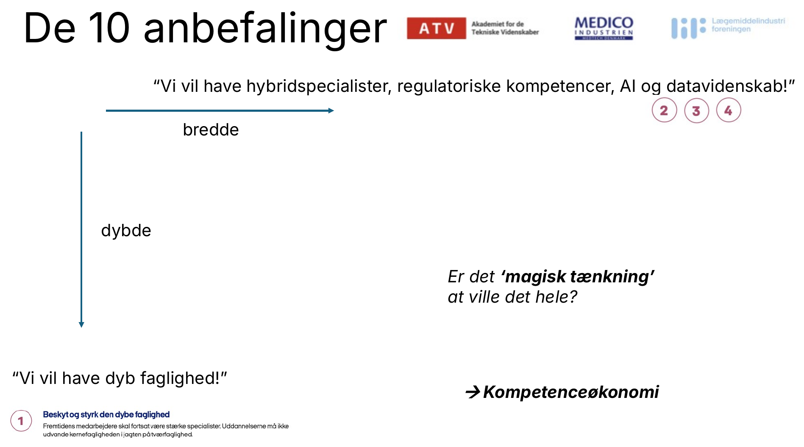
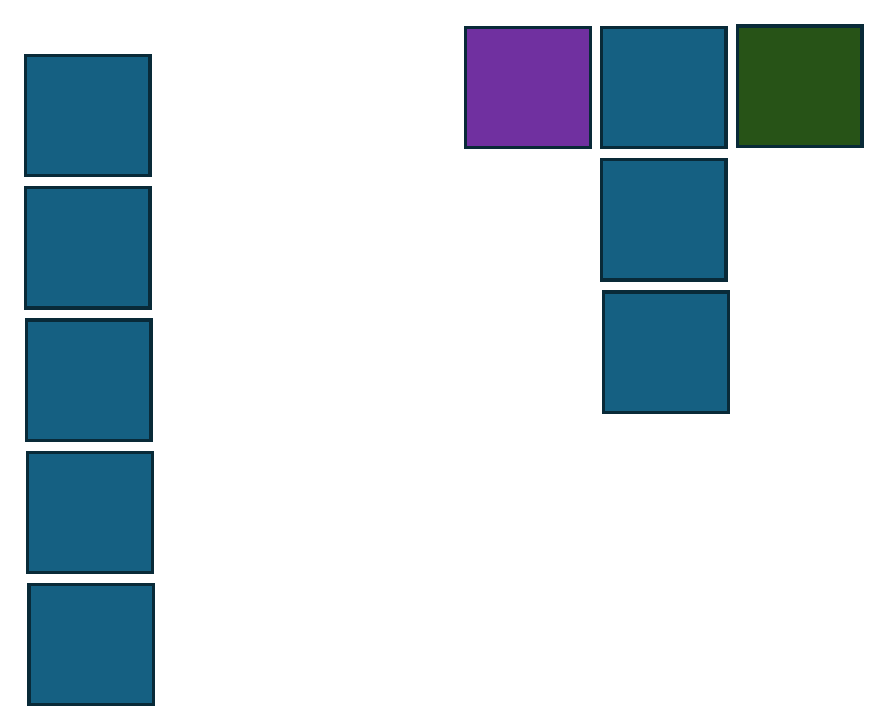
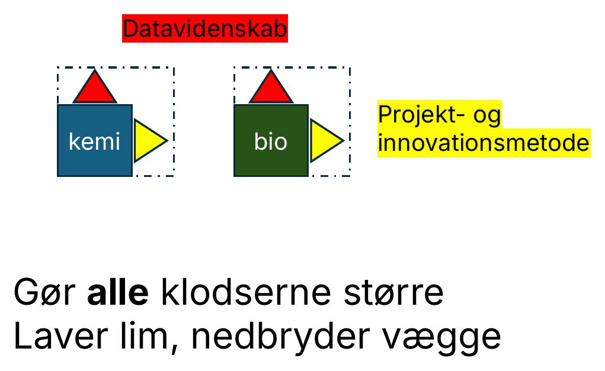
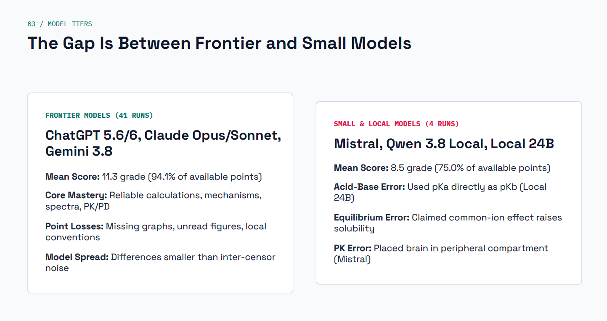
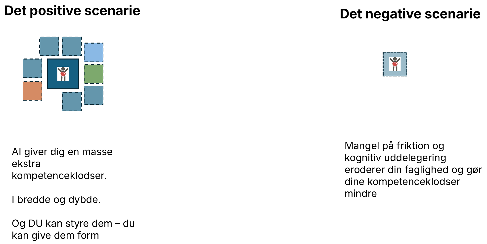
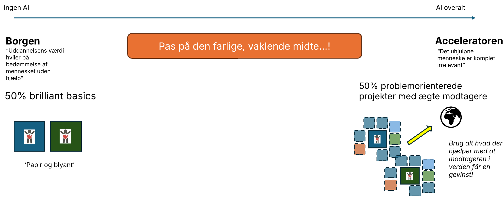
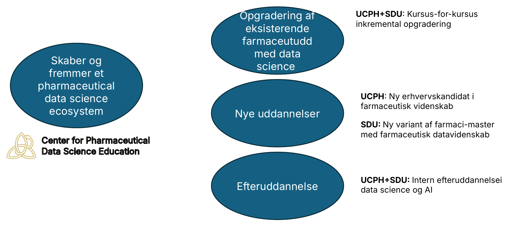
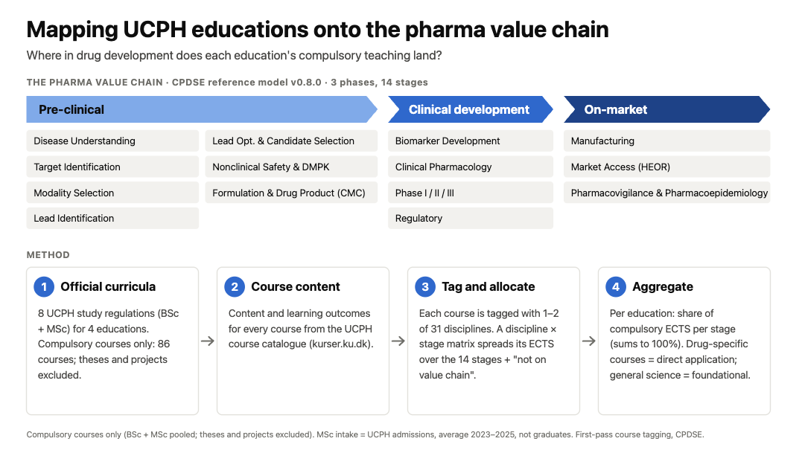
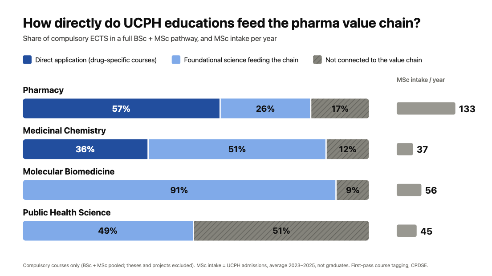
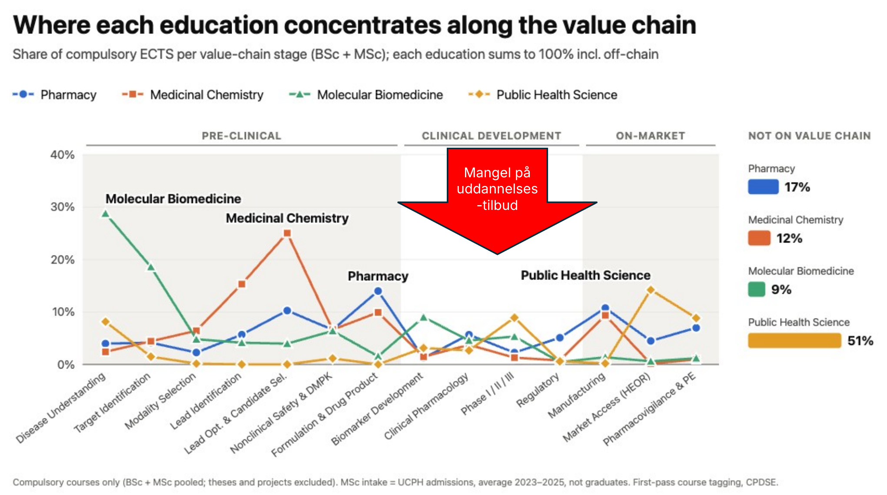

Den 26. oktober 2026 holdt jeg et indlæg om de nye "10 anbefalinger til fremtidens life science-kompetencer", som Lægemiddelindustriforeningen, Medicoindustrien og ATV har lavet ([læs dokumentet her](https://www.lif.dk/wp-content/uploads/2026/10/10-anbefalinger-til-fremtidens-LifeScience-kompetencer.pdf)). Indlægget fik  meget opmærksomhed, så her er det i skriftlig form, med figurerne fra de slides jeg havde med.

## De 10 anbefalinger – og en indbygget spænding

De er opdelt i to grupper. *En stærk life science-faglighed* (anbefaling 1–5) handler om at beskytte den dybe faglighed, integrere AI- og dataforståelse, opbygge regulatoriske kompetencer, udvikle "hybridspecialister" og styrke kompetencerne inden for forskning, innovation og kliniske forsøg. *Styrket organisering og samarbejde* (6–10) handler om en national kompetencestrategi, stærkere og mere konsoliderede fagmiljøer, samarbejde mellem universiteter, virksomheder og myndigheder, livslang læring og tiltrækning af internationalt talent.

Læs dem i deres helhed – de er rigtig gode. Men læs de første fire side om side, og der opstår en spænding.

**Figur 1.** Anbefalingerne trækker i to retninger: dybde (anbefaling 1) og bredde (anbefaling 2–4). Er det "magisk tænkning" at ville det hele?

Anbefaling 1 siger, at uddannelserne "ikke må udvande kernefagligheden i jagten på tværfaglighed". Anbefaling 2, 3 og 4 beder om AI- og dataforståelse, regulatorisk viden og evnen til at "tale flere sprog". Er det *magisk tænkning* at ville begge dele? Det er det, hvis vi tænker i et nulsumsspil, hvor hver time på AI er en time væk fra kemien. Det er derfor et spørgsmål om **kompetenceøkonomi**: Hvordan får vi mest muligt ud af de timer, vi har?

## Kompetenceklodser: I-former og T-former

Et billede, jeg selv bruger: Se hver kompetence som en klods. Hvordan stabler vi dem?

**Figur 2.** Til venstre en I-form: ved alt om kemi, men forstår ikke sammenhængen med andet. Til højre en T-form: ved meget om kemi og forstår en del fysik og biologi.

*Spørgsmålet til dig, der skal sammensætte det næste projektteam: Vil du have flere I-formede eller T-formede kolleger?*

### Støttefaglighed er limen

Det interessante er, hvad der gør T'et muligt. Hver klods bliver ikke bare større af at have flere nabo-klodser – den bliver større, når den støttes af to tværgående kompetencer.

**Figur 3.** Datavidenskab og projekt- og innovationsmetode som støttefaglighed: de gør *alle* klodserne større, laver lim og nedbryder vægge mellem fagene.

Datavidenskab og projekt- og innovationsmetode er ikke endnu et fag ved siden af de andre. De fungerer som lim: De gør kemien bedre, biologien bedre og samarbejdet mellem dem bedre. Det er dér, jeg mener, at anbefaling 1 og 2–4 kan forenes.

## Hvad med AI?

Så kommer elefanten i rummet. Jakob Sture Madsen er i gang med en evaluering, hvor AI-modeller løser opgaver fra vores bachelor i farmaci. Foreløbigt er konklusionen, at **alle testede modeller kan bestå**.

**Figur 4.** Igangværende evaluering (Jakob Sture Madsen): Frontier-modeller (41 kørsler) opnår i gennemsnit karakteren 11,3 (94,1 % af pointene); små og lokale modeller (4 kørsler) 8,5 (75,0 %). Forskellen mellem modellerne er mindre end uenigheden mellem censorer. Foreløbige resultater.

De frontier-modeller, der blev testet, regner pålideligt på mekanismer, spektre og PK/PD. De mister primært point på manglende grafer, figurer, de ikke har læst, og lokale konventioner. De små og lokale modeller laver mere grundlæggende fejl, for eksempel at bruge pKa direkte som pKb. Men de består også.

Det rejser et ubehageligt spørgsmål:

**Er det OK, at AI kan bestå alle eksamenerne?**

### To scenarier

AI kan trække i to helt forskellige retninger:

**Figur 5.** Det positive og det negative scenarie.

- **Det positive scenarie:** AI giver dig en masse ekstra kompetenceklodser – i bredde og dybde. Og *du* kan styre dem og give dem form.
- **Det negative scenarie:** Mangel på friktion og kognitiv uddelegering eroderer din faglighed og gør dine kompetenceklodser mindre.

Forskellen mellem de to er ikke teknologien. Det er, om der er en kerne af faglighed, der kan styre den.

## Hvordan laver vi uddannelse, når AI findes?

Der er to klare yderpositioner. *Borg-positionen* siger: "Uddannelsens værdi hviler på bedømmelse af mennesket uden hjælp." *Accelerator-positionen* siger: "Det uhjulpne menneske er komplet irrelevant." Begge er egentlig konsistente.

Det farlige er den vaklende midte, hvor vi lader AI sive ind lidt overalt uden at beslutte, hvad vi egentlig tester og træner. Måske laver vi en lille guideline her og der, en AI-deklaration om, at AI må bruges til korrektur, men ikke til disposition osv.

**Figur 6.** Fra Borgen til Acceleratoren. Pas på den farlige, vaklende midte.

Mit forslag er at vælge begge ender – og holde dem skarpt adskilt:

- **50 % brilliant basics.** Papir og blyant. Her bygger vi de uhjulpne kompetenceklodser, og her tester vi dem.
- **50 % problemorienterede projekter med ægte modtagere.** Her er alt tilladt, der hjælper modtageren i verden udenfor til en gevinst. All-in-AI.

Det kan koges ned til en enkelt anbefaling, som jeg låner fra Anders Bæk:

> **Lær uden AI, for at blive god med AI.**

## Hvad gør vi konkret på farmaområdet?

På Center for Pharmaceutical Data Science Education (CPDSE) arbejder vi på tre spor samtidig, på tværs af Københavns Universitet (UCPH) og Syddansk Universitet (SDU):

**Figur 7.** CPDSE skaber og fremmer et pharmaceutical data science ecosystem gennem tre spor.

- **Opgradering af eksisterende farmaceutuddannelser** med data science – kursus for kursus, inkrementelt, på UCPH og SDU.
- **Nye uddannelser:** På UCPH en ny erhvervskandidat i farmaceutisk videnskab. På SDU en ny variant af farmaci-masteren med farmaceutisk datavidenskab.
- **Efteruddannelse:** Intern efteruddannelse i data science og AI på både UCPH og SDU.

## Kan vi bruge AI og datavidenskab *på* uddannelse?

Til sidst et eksempel på, at vi også kan vende blikket mod selve uddannelseslandskabet: Kan AI og datavidenskab bruges til at kortlægge, analysere og planlægge uddannelser? Her er et simpelt eksempel på en analyse af fire life science-uddannelser på UCPH.

Metoden er enkel. Vi tager de officielle studieordninger, trækker kursusindhold og læringsudbytte fra kursuskataloget, tagger hvert kursus med en eller to af 31 discipliner og fordeler dets ECTS over 14 trin i den farmaceutiske værdikæde. Til sidst aggregerer vi pr. uddannelse.

**Figur 8.** Kortlægning af UCPH-uddannelser på den farmaceutiske værdikæde (CPDSE referencemodel v0.8.0). Kun obligatoriske kurser: 86 kurser fra 8 studieordninger på 4 uddannelser; specialer og projekter er udeladt.

Første resultat: Hvor direkte føder uddannelserne ind i værdikæden?

**Figur 9.** Andel af obligatoriske ECTS i et fuldt bachelor- og kandidatforløb, samt kandidatoptag pr. år (gennemsnit 2023–2025, optag og ikke dimittender). Farmaci: 57 % direkte anvendelse, 26 % fundamental videnskab, 17 % ikke forbundet med værdikæden.

Og endnu mere interessant: Hvor på værdikæden koncentrerer hver uddannelse sig?

**Figur 10.** Hvor hver uddannelse koncentrerer sig langs værdikæden. Rød pil: mangel på uddannelsestilbud i den kliniske udvikling.

Billedet er tydeligt: Præklinikken er godt dækket, og de fire uddannelser har hver deres tyngdepunkt. Men i den kliniske udviklingsfase ligger alle fire lavt, omkring eller under 10 %. Det er et hul, man ikke ser ved at læse studieordninger enkeltvis, men som kommer frem, når man lægger dem oven på hinanden – og det er netop pointen med anbefaling 7 om at konsolidere og koordinere fagmiljøerne.

Bemærk, at det er en *første gennemgang* med en enkel kategorisering af kurserne. Det er et eksempel på, hvad der er muligt, ikke en færdig analyse. Men det viser, at vi hurtigt kan få et fælles billede af uddannelseslandskabet og pege på, hvor der mangler tilbud (analysen her stemmer overens med de 10 anbefalinger om, at der er mangel på tilbud inden for klinisk udvikling og regulatory science).

## Hvad du kan tænke over nu

Jeg sluttede indlægget med fire spørgsmål, som jeg gerne vil have, at du tager med:

1. Vil du have flere I- eller T-formede kolleger til dit næste projekt?
2. Er det OK, at AI kan bestå alle eksamenerne?
3. Er du enig i, at vi skarpt skal adskille *brilliant basics* med *papir og blyant* fra all-in-AI-projektarbejde, der giver gevinst i verden udenfor?
4. Hvordan kan vi bruge AI og datavidenskab til at analysere og planlægge selve life science-uddannelseslandskabet – og hurtigt skabe nye uddannelsestilbud?

*AI har hjulpet med at skrive dette indlæg, der er lavet på baggrund af mit foredrag, som jeg har sat sammen uden AI.*
